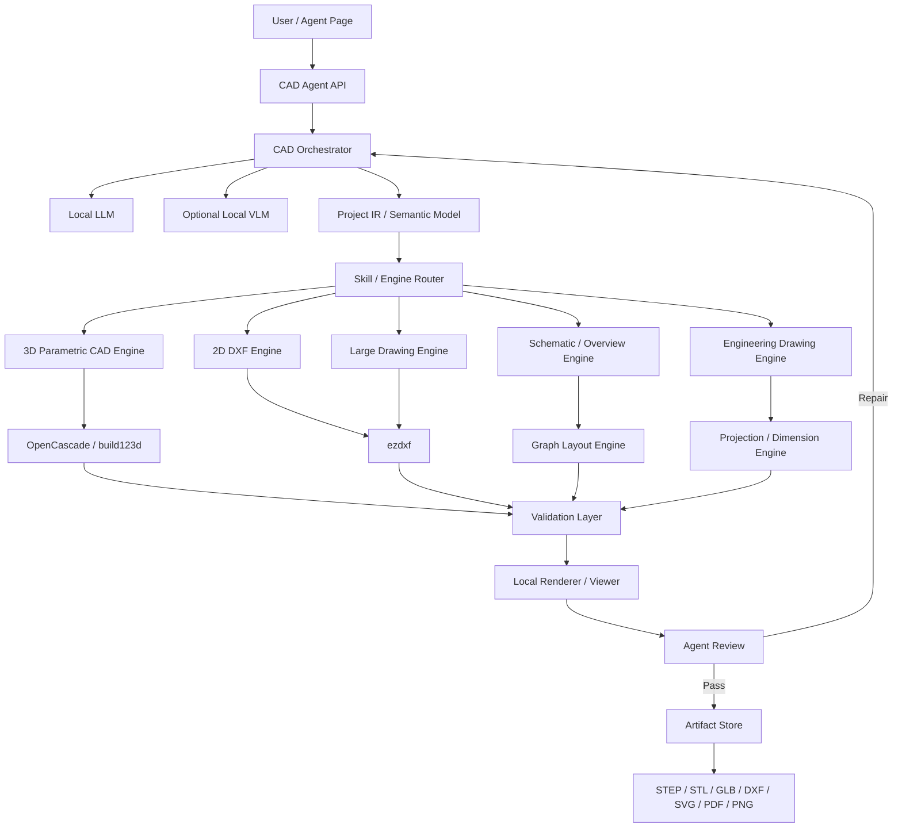
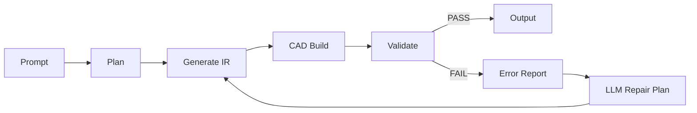
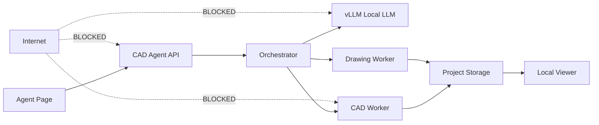

# 폐쇄망 로컬 통합 CAD Agent 아키텍처
## 2D · 3D · 단일 부품 · 대형 설계도면 · 개황도 통합 생성 플랫폼

> 문서 목적  
> 자연어 또는 기존 설계자료를 입력으로 받아 **단일 3D 부품, 2D 가공도, 조립/시스템 3D, 대형 설비·ICT 배치도, 계통도·개황도, 기술도면**을 생성·수정·검증할 수 있는 **완전 로컬/폐쇄망 CAD Agent**의 기준 아키텍처를 정의한다.

---

# 1. 목표

이 시스템의 목표는 단순한 `Text-to-CAD`가 아니다.

다음 요구를 하나의 플랫폼에서 처리한다.

1. **3D 단일 부품 생성**
   - 브래킷, 케이스, 플레이트, 지그 등
   - 자연어 → Parametric CAD → STEP/STL/3MF/GLB

2. **2D 단일 부품/가공도 생성**
   - 판재, 가스켓, 패널, 절단 형상
   - 자연어 → DXF

3. **3D Assembly / System Model**
   - 여러 부품의 배치 및 조립
   - 장비/랙/설비 배치
   - STEP/GLB 중심

4. **대형 2D 설계도면**
   - 지하철역 ICT
   - 공장 설비
   - CCTV/AP/통신장비 배치
   - 배관/케이블/전기·통신 계통
   - DXF 기반

5. **개황도 / 계통도 / 구성도**
   - ICT 시스템 구성도
   - Network topology
   - CCTV 계통도
   - Fiber backbone
   - 장비 연결관계
   - SVG/PDF/DXF 출력

6. **기존 도면 수정**
   - 기존 DXF 불러오기
   - Layer/Block/Text/Entity 분석
   - 특정 장비 추가·이동·삭제
   - 변경본 Save-As

7. **도면 검증**
   - Geometry validation
   - Layer/Block 규칙
   - 연결관계 검증
   - 포트/수량/케이블 규칙
   - 사용자 정의 설계 Rule

8. **완전 폐쇄망 운영**
   - 외부 API 호출 없음
   - Local LLM/VLM
   - Local CAD kernel
   - Local Viewer
   - Local artifact storage
   - Network egress 차단

---

# 2. 핵심 설계 원칙

## 2.1 LLM이 CAD 파일을 직접 작성하지 않는다

금지 구조:

```text
User
 ↓
LLM
 ↓
수천 개 DXF 좌표 직접 생성
 ↓
DXF
```

이 방식은 다음 문제가 발생한다.

- 치수 오차
- 좌표 hallucination
- 연결 누락
- Layer/Block 일관성 붕괴
- 수정 시 전체 도면 재생성
- 대형 도면에서 context 폭발

권장 구조:

```text
User
 ↓
Local LLM
 ↓
Semantic Project IR
 ↓
Deterministic CAD Engine
 ↓
DXF / STEP / SVG / PDF
```

LLM은 **설계 의도와 구조를 판단**하고,
실제 Geometry 생성은 deterministic engine이 담당한다.

---

# 3. 전체 아키텍처



---

# 4. 시스템 계층

## Layer 1. User Interface

### 권장

- 기존 사내 Agent Page
- Web 기반
- CAD 자체 UI를 사용자가 직접 다루지 않아도 됨

### 주요 UI

```text
[Prompt]
"지하철역 B2 승강장 ICT 배치도 초안 작성.
CCTV 12대, AP 4대, 비상통화장치 4대.
통신실은 B1이고 Access SW 2대를 통해 Core SW 이중화."

[첨부]
station_B1_B2.dxf

[생성 종류]
○ 자동
○ 2D 배치도
○ 3D
○ 개황도
○ 기술도면

[실행]
```

결과:

```text
Project
 ├─ station_ict_layout.dxf
 ├─ ict_system_overview.svg
 ├─ ict_system_overview.pdf
 ├─ equipment_schedule.csv
 ├─ validation_report.md
 └─ preview/
```

---

# 5. Local AI Layer

## 5.1 Local LLM

LLM의 역할:

- 사용자 요구 분석
- 작업 유형 분류
- 설계 parameter 추출
- Project IR 작성
- 기존 도면 semantic 분석 결과 해석
- CAD tool 호출
- validation 결과 해석
- repair 계획 작성

### 권장 운영방식

GPU 서버:

```text
vLLM
  ↓
OpenAI-compatible local endpoint
  ↓
CAD Agent
```

소규모 PC/PoC:

```text
Ollama / llama.cpp
```

### 모델 요구사항

모델명보다 다음 능력이 중요하다.

- Code generation
- JSON structured output
- Tool calling
- Multi-step planning
- Long context
- CAD/engineering terminology 처리

권장 모델 규모:

```text
PoC             : 14B~32B
실무 Agent      : 32B~70B급 이상
복잡한 설계     : 가능한 범위에서 상위 모델
```

---

# 6. Optional Local VLM

이미지/스캔/PDF 도면이 들어올 경우 별도 VLM을 둔다.

```text
도면 Image/PDF
     ↓
Local VLM
     ↓
문자 / 기호 / 공간 / 치수 후보
     ↓
Semantic Extraction
```

VLM이 최종 CAD를 직접 만들지는 않는다.

VLM 출력 예:

```json
{
  "rooms": [
    {"name": "통신실", "bbox": [1200, 400, 3200, 1800]},
    {"name": "승강장", "bbox": [500, 2200, 8800, 5100]}
  ],
  "detected_symbols": [],
  "dimensions": []
}
```

---

# 7. 핵심: Project IR

통합 시스템에서 가장 중요한 모듈이다.

## 7.1 목적

3D Part와 지하철 ICT 도면을 같은 방법으로 직접 그릴 수는 없다.

대신 상위 개념을 공통 Semantic IR로 관리한다.

```text
Project IR
 ├─ Spaces
 ├─ Equipment
 ├─ Parts
 ├─ Connections
 ├─ Constraints
 ├─ Views
 ├─ Sheets
 ├─ Layers
 └─ Rules
```

---

## 7.2 예시: 지하철 ICT

```json
{
  "project": {
    "name": "Station ICT Draft",
    "unit": "mm"
  },

  "spaces": [
    {
      "id": "B1_COMM",
      "type": "communication_room",
      "floor": "B1"
    },
    {
      "id": "B2_PLATFORM",
      "type": "platform",
      "floor": "B2"
    }
  ],

  "equipment": [
    {
      "id": "CORE_SW_01",
      "type": "core_switch",
      "space": "B1_COMM"
    },
    {
      "id": "CCTV_01",
      "type": "cctv",
      "space": "B2_PLATFORM"
    }
  ],

  "connections": [
    {
      "from": "CCTV_01",
      "to": "ACCESS_SW_01",
      "medium": "CAT6"
    },
    {
      "from": "ACCESS_SW_01",
      "to": "CORE_SW_01",
      "medium": "SM_FIBER"
    }
  ],

  "rules": [
    "dual_core",
    "no_unconnected_equipment"
  ]
}
```

이 IR에서 다음을 동시에 생성할 수 있다.

```text
ICT Layout DXF
ICT System Overview
Fiber Diagram
Equipment Schedule
Cable Schedule
BOM
```

---

# 8. Skill Router

사용자 요청을 다음 타입으로 분류한다.

```text
PART_3D
PART_2D
ASSEMBLY_3D
ENGINEERING_DRAWING
LAYOUT_2D
SCHEMATIC
SYSTEM_OVERVIEW
EDIT_EXISTING_DRAWING
DRAWING_ANALYSIS
```

예:

```text
"모터 브래킷 만들어줘"
→ PART_3D

"이 판재 DXF 만들어줘"
→ PART_2D

"이 STEP에서 3면도 만들어줘"
→ ENGINEERING_DRAWING

"지하철역 CCTV 배치도 초안"
→ LAYOUT_2D

"ICT 전체 개황도 만들어줘"
→ SYSTEM_OVERVIEW

"이 DXF에서 AP 4개 추가"
→ EDIT_EXISTING_DRAWING
```

---

# 9. 3D CAD Engine

## 기반

권장:

```text
text-to-cad Skill
       +
cadgen
       +
build123d
       +
OpenCascade/OCP
```

Reference:
- https://github.com/earthtojake/text-to-cad

현재 text-to-cad는 자연어/이미지 기반 3D CAD와 STEP 중심 workflow를 제공하며
STL/3MF/GLB export도 지원한다.

## 출력

```text
STEP   ← 표준 교환 포맷
STL    ← Mesh
3MF    ← 3D Printing
GLB    ← Web Viewer
```

## 역할

- Part 생성
- Assembly 생성
- Hole / Fillet / Chamfer
- Boolean
- Parametric dimensions
- Geometry inspection
- Snapshot
- Repair loop

---

# 10. 2D Part Engine

간단한 2D profile 및 제조도는 text-to-cad의 DXF Skill을 활용할 수 있다.

Reference:
- https://github.com/earthtojake/text-to-cad/tree/main/skills/dxf

예:

```text
"100 x 80 x 5 판에 Ø6 구멍 네 개.
모서리에서 각각 10 mm."
```

↓

```text
build123d geometry
 ↓
cadgen
 ↓
DXF
```

적합 분야:

- 판재
- 가스켓
- 패널
- Cutting profile
- Laser / Plasma / Waterjet
- Flat pattern

---

# 11. Large Drawing Engine

지하철 ICT와 같은 대형 도면은 별도 엔진으로 처리한다.

## 기반

```text
ezdxf
+
Semantic Operation Layer
+
Block Library
+
Layer Standard
```

Reference architecture:
- https://github.com/jeremylongshore/cad-ai-agent

이 프로젝트의 중요한 철학은:

> LLM은 raw DXF를 직접 수정하지 않고,
> 구조화된 operation을 생성한다.

이를 그대로 채택한다.

---

## 11.1 Operation 예

LLM 출력:

```json
{
  "operation": "add_equipment",
  "type": "CCTV",
  "block": "ICT_CCTV_FIXED",
  "position": [18200, 7700],
  "rotation": 90,
  "layer": "ICT-CCTV",
  "attributes": {
    "id": "CCTV-021"
  }
}
```

Drawing Engine:

```text
validate
 ↓
DXF INSERT
 ↓
Attribute 적용
 ↓
save-as
```

LLM이 직접 DXF entity를 작성하지 않는다.

---

# 12. Block / Symbol Library

대형 설계 자동화에서 매우 중요하다.

```text
library/
├─ ict/
│   ├─ CCTV_FIXED.dxf
│   ├─ CCTV_PTZ.dxf
│   ├─ WIFI_AP.dxf
│   ├─ SWITCH_L2.dxf
│   ├─ SWITCH_CORE.dxf
│   ├─ NVR.dxf
│   ├─ UPS.dxf
│   └─ RACK.dxf
│
├─ electrical/
├─ mechanical/
├─ fire/
└─ architecture/
```

Block metadata:

```yaml
id: ICT_CCTV_FIXED
category: CCTV
ports:
  - network
  - power
default_layer: ICT-CCTV
scale: 1.0
```

---

# 13. Layer Standard

예:

```text
A-WALL
A-DOOR
A-ROOM

ICT-CCTV
ICT-WIFI
ICT-NETWORK
ICT-FIBER
ICT-UTP
ICT-RACK
ICT-CABLE
ICT-TEXT
ICT-DIM
ICT-EQUIPMENT
ICT-ANNOTATION
```

회사 또는 프로젝트 CAD 표준을 별도 config로 둔다.

```yaml
standard: COMPANY_ICT_V1

layers:
  CCTV:
    name: ICT-CCTV
  WIFI:
    name: ICT-WIFI
```

---

# 14. Schematic / 개황도 Engine

개황도는 CAD Geometry 문제라기보다 **Graph Layout 문제**다.

따라서 별도 엔진을 둔다.

```text
Project IR
   ↓
Network Graph
   ↓
Graph Layout Engine
   ↓
SVG
   ↓
PDF
   ↓
Optional DXF Conversion
```

추천 구성:

```text
NetworkX
+
Graphviz 또는 ELK 계열 layout
+
SVG renderer
+
DXF exporter
```

예:

```text
               ┌─────────────┐
               │ VMS / NVR   │
               └──────┬──────┘
                      │
            ┌─────────┴─────────┐
            │                   │
       CORE-SW-01          CORE-SW-02
            │                   │
       ─────┴───────────────┬───┘
                            │
           ┌────────────────┼──────────────┐
           │                │              │
       ACCESS-01        ACCESS-02      ACCESS-03
           │                │
       CCTV/AP          CCTV/AP
```

이 방식으로 다음을 자동 생성한다.

- ICT 개황도
- Network topology
- Fiber backbone
- CCTV system diagram
- Control system overview
- Power distribution overview

---

# 15. Engineering Drawing Engine

3D 모델에서 정식 기술도면 생성.

입력:

```text
Part.step
```

출력:

```text
Part_Drawing.pdf
Part_Drawing.dxf
```

포함 가능 항목:

- Front
- Top
- Side
- Isometric
- Hidden line
- Dimensions
- Hole callout
- Title block

text-to-cad에도 Engineering Drawing Skill이 있으므로
초기 구현에서 활용할 수 있다.

---

# 16. 기존 DXF 분석/수정

기존 도면은 절대 원본 overwrite하지 않는다.

```text
station_original.dxf
         ↓
    DXF Parser
         ↓
 Semantic Index
         ↓
 Agent Operation
         ↓
station_rev_A.dxf
```

Semantic Index:

```text
Layer
Block
Text
Entity
Room/Zone
Equipment
Connection
```

Reference:
`cad-ai-agent`는 DXF 분석·수정, block/text/entity operation,
zone detection, drawing summary, revision comparison 등의 구현 참고에 적합하다.

---

# 17. 3D + 2D 연계

통합 플랫폼의 중요한 기능이다.

## 3D → 2D

```text
STEP
 ↓
Projection
 ↓
DXF / PDF
```

## 2D → 3D

단순 profile:

```text
DXF closed profile
 ↓
Extrude
 ↓
STEP
```

대형 도면:

```text
2D Layout
 ↓
Semantic Recognition
 ↓
Space / Equipment IR
 ↓
3D placement
 ↓
GLB / STEP
```

예:

```text
지하철역 ICT 배치 DXF
        ↓
장비 위치 추출
        ↓
Rack / CCTV / AP 3D asset mapping
        ↓
3D Station ICT Model
```

---

# 18. Asset Library

외부 인터넷 없이 사용할 자산을 내부 library에 저장한다.

```text
assets/
├─ 3d/
│   ├─ rack/
│   ├─ cctv/
│   ├─ switches/
│   └─ generic/
│
├─ blocks/
│   ├─ ict/
│   ├─ electrical/
│   └─ mechanical/
│
├─ symbols/
├─ titleblocks/
└─ templates/
```

각 Asset은 metadata를 가진다.

```json
{
  "id": "RACK_42U_GENERIC",
  "type": "rack",
  "step": "3d/rack/42u.step",
  "dxf_block": "blocks/ict/rack_42u.dxf"
}
```

---

# 19. Validation Layer

생성보다 검증이 더 중요하다.

## 19.1 3D

검사:

```text
Geometry valid
Volume > 0
Self-intersection
Bounding box
Hole diameter
Wall thickness
Collision
```

---

## 19.2 2D Part

```text
Closed contour
No duplicate geometry
No illegal intersections
Layer validation
Units
Minimum feature size
```

---

## 19.3 Large Drawing

```text
Layer naming
Required blocks
Duplicate equipment ID
Unconnected equipment
Cable endpoint
Switch port capacity
Rack capacity
Required redundancy
Zone rule
```

---

## 19.4 ICT 예

```text
CCTV-01
   ↓ CAT6
ACCESS-SW-01
   ↓ Fiber
CORE-SW-01
```

CCTV가 Core까지 연결되지 않으면:

```text
ERROR ICT-CONNECTION-001

CCTV-01 has no valid path to CORE network.
```

---

# 20. Rule Engine

LLM 판단과 Engineering Rule을 분리한다.

예:

```yaml
rules:

  - id: ICT-001
    name: equipment_connection_required
    severity: error

  - id: ICT-002
    name: core_redundancy
    min_core_switches: 2
    severity: warning

  - id: ICT-003
    name: access_switch_port_margin
    margin: 0.2
```

규정이나 사내 설계기준이 변경되어도 LLM을 다시 학습할 필요 없이 Rule을 수정한다.

---

# 21. Agent Repair Loop



최대 반복 횟수를 제한한다.

예:

```text
MAX_REPAIR_ATTEMPTS = 3
```

---

# 22. Generated Code Sandbox

3D CAD는 LLM이 Python code를 생성할 수 있으므로 반드시 sandbox에서 실행한다.

```text
LLM
 ↓
Generated Python
 ↓
Sandbox Worker
```

Sandbox:

```text
No Internet
Read-only base filesystem
Project workspace only writable
CPU limit
Memory limit
Execution timeout
Process limit
No host shell access
```

권장:

```text
Docker / Podman container
+
seccomp / AppArmor
```

---

# 23. 폐쇄망 배포 구성



---

# 24. 권장 Container 구성

```text
cad-platform/

├─ agent-api
│   └─ FastAPI

├─ llm-service
│   └─ vLLM

├─ cad-3d-worker
│   ├─ cadgen
│   ├─ build123d
│   └─ OpenCascade

├─ cad-2d-worker
│   └─ ezdxf

├─ schematic-worker
│   ├─ graph layout
│   └─ SVG/PDF renderer

├─ validation-worker

├─ viewer

└─ project-storage
```

---

# 25. 추천 Backend 기술 스택

| 영역 | 권장 |
|---|---|
| API | FastAPI |
| Agent | Python |
| Local LLM | vLLM |
| Lightweight LLM | Ollama / llama.cpp |
| 3D CAD | build123d + OpenCascade |
| CAD workflow | cadgen / text-to-cad |
| 2D DXF | ezdxf |
| Graph | NetworkX |
| Auto Layout | Graphviz / ELK 계열 |
| Vector | SVG |
| PDF | Local renderer |
| Database | PostgreSQL 또는 SQLite |
| Queue | Redis optional |
| Sandbox | Docker / Podman |
| Web Viewer | Local GLB/DXF viewer |

---

# 26. Format 정책

## 내부 Canonical

시스템 설계:

```text
Project IR = JSON / DB
```

3D Part:

```text
Parametric Python Source
+
STEP
```

2D Drawing:

```text
DXF
```

Diagram:

```text
SVG
```

---

## Output

```text
3D
 ├─ STEP
 ├─ STL
 ├─ 3MF
 └─ GLB

2D CAD
 └─ DXF

Diagram
 ├─ SVG
 ├─ PDF
 └─ DXF

Report
 ├─ PDF
 ├─ MD
 └─ CSV
```

---

# 27. DWG 정책

DWG를 플랫폼의 canonical format으로 사용하지 않는 것을 권장한다.

기본:

```text
DXF
```

DWG가 반드시 필요한 경우:

```text
DXF
 ↓
ODA File Converter
 ↓
DWG
```

단:

- 별도 설치
- 라이선스 검토
- 폐쇄망 배포 가능 여부 확인

가 필요하다.

`cad-ai-agent` 역시 native DWG editing이 아니라
선택적 ODA File Converter 경로를 사용한다.

---

# 28. 프로젝트 폴더 구조

```text
projects/
└─ station_001/

   ├─ project.yaml
   ├─ ir/
   │   ├─ project.json
   │   ├─ equipment.json
   │   ├─ connections.json
   │   └─ rules.json
   │
   ├─ input/
   │   ├─ architecture.dxf
   │   └─ requirements.pdf
   │
   ├─ parts/
   │   ├─ rack.py
   │   ├─ rack.step
   │   └─ enclosure.step
   │
   ├─ drawings/
   │   ├─ ict_layout.dxf
   │   ├─ fiber_layout.dxf
   │   └─ rack_layout.dxf
   │
   ├─ diagrams/
   │   ├─ ict_overview.svg
   │   ├─ network.svg
   │   └─ fiber.svg
   │
   ├─ reports/
   │   ├─ validation.md
   │   ├─ equipment_schedule.csv
   │   └─ cable_schedule.csv
   │
   ├─ snapshots/
   │
   └─ revision/
       ├─ R00/
       ├─ R01/
       └─ R02/
```

---

# 29. 예시 1 — 단일 3D Part

사용자:

```text
폭 80 mm, 높이 40 mm, 두께 6 mm 브래킷.
Ø6.5 구멍 두 개.
```

Pipeline:

```text
Prompt
 ↓
PART_3D
 ↓
Parametric Plan
 ↓
build123d
 ↓
STEP
 ↓
Geometry Validation
 ↓
Snapshot
```

---

# 30. 예시 2 — 단일 2D Part

```text
200 x 100 판재.
모서리 R10.
M6 clearance hole 네 개.
```

↓

```text
PART_2D
 ↓
build123d 2D
 ↓
DXF
```

---

# 31. 예시 3 — 지하철역 ICT Layout

입력:

```text
station.dxf

B2 승강장:
CCTV 12
AP 4
Emergency Phone 4

B1:
Communication Room

Core Switch 2
Access Switch 4
```

Pipeline:

```text
Existing DXF
 ↓
Space Detection
 ↓
Project IR
 ↓
Equipment Allocation
 ↓
Placement Rule
 ↓
DXF Block Placement
 ↓
Cable Routing
 ↓
Validation
 ↓
station_ICT_R00.dxf
```

---

# 32. 예시 4 — ICT 개황도

동일 Project IR 사용:

```text
Project IR
 ↓
Connection Graph
 ↓
Automatic Layout
 ↓
ict_overview.svg
 ↓
PDF
```

따라서 배치도와 개황도 간 장비 수량/ID 불일치가 줄어든다.

---

# 33. 예시 5 — 3D Digital Mock-up

2D ICT Layout의 장비 위치를 활용:

```text
ICT Layout
 ↓
Equipment Coordinates
 ↓
3D Asset Library
 ↓
Placement
 ↓
Station ICT GLB
```

Web Viewer에서:

```text
Station
 ├─ Rack
 ├─ CCTV
 ├─ AP
 └─ Cable Tray
```

확인 가능.

---

# 34. Human-in-the-loop

시스템 목표는 **설계자 대체가 아니라 Draft Automation**으로 정의하는 것이 안전하다.

최종 상태:

```text
AI Draft
 ↓
Rule Validation
 ↓
Engineer Review
 ↓
Approved Revision
```

사용자가 승인하기 전에는:

```text
DRAFT
NOT FOR CONSTRUCTION
```

상태를 유지한다.

---

# 35. 권한 및 보안

필수:

```text
Network egress = deny
```

추가:

- Model weight 내부 저장
- Python wheel 내부 mirror
- Node/npm asset 내부 mirror 또는 사전 번들
- Chromium 사전 설치
- OS package 사전 mirror
- Container image 내부 registry
- 외부 telemetry 차단
- generated code sandbox
- audit log
- project ACL

---

# 36. 폐쇄망 반입 패키지

인터넷 가능 Build Zone:

```text
models/
python-wheels/
npm-cache/
chromium/
container-images/
cad-assets/
symbol-library/
source/
```

↓

```text
tar / OCI bundle
```

↓

폐쇄망 내부 Registry/Repository에 import.

운영 중 인터넷 다운로드가 발생하면 안 된다.

---

# 37. Local Parts / Asset Repository

외부 `step.parts` 같은 서비스는 운영망에서 직접 호출하지 않는다.

필요하면 승인된 부품을 내부로 mirror한다.

```text
Internal CAD Asset Repository

part_id
manufacturer
category
STEP
DXF
preview
metadata
license
```

Agent:

```text
"42U rack generic"
 ↓
Local Search
 ↓
Internal STEP asset
```

---

# 38. 검색은 RAG보다 Asset/Metadata Search 중심

CAD 시스템에서 모든 정보를 Vector RAG로 풀 필요는 없다.

권장:

```text
Structured Metadata
+
SQL
+
Symbol/Part Catalog
+
Rule DB
```

예:

```sql
SELECT *
FROM assets
WHERE category='CCTV'
AND environment='indoor';
```

문서 규정이 필요할 때만 별도 문서 검색 계층을 추가한다.

---

# 39. Revision 관리

각 Agent 작업을 operation log로 기록한다.

```json
{
  "revision": "R03",
  "operations": [
    {
      "type": "move",
      "entity": "CCTV-03",
      "from": [1000,2000],
      "to": [1500,2200]
    }
  ]
}
```

산출물:

```text
R02
 ↓
AI Change
 ↓
R03 Draft
 ↓
Human Approve
 ↓
R03 Approved
```

---

# 40. 추천 구현 단계

## Phase 1 — 기본 통합 PoC

목표:

```text
Prompt
→ Local LLM
→ 3D STEP
→ 2D DXF
→ 개황도 SVG
```

구현:

- vLLM
- text-to-cad
- build123d
- ezdxf
- Graphviz
- FastAPI

---

## Phase 2 — Project IR

추가:

- Project schema
- Equipment
- Connection
- Space
- Asset library

이 단계부터 대형 설계도면 대응 가능.

---

## Phase 3 — ICT Pilot

대상:

```text
지하철역 ICT
```

구현:

- CCTV block
- AP block
- Network switch
- Rack
- Fiber
- UTP
- Equipment schedule
- System overview

---

## Phase 4 — Existing Drawing Intelligence

추가:

- Existing DXF analysis
- Zone detection
- Block recognition
- Text parsing
- Save-as editing
- Drawing diff

---

## Phase 5 — Validation

추가:

- Engineering rule engine
- Port capacity
- Connectivity
- redundancy
- drawing standard
- collision / geometry checks

---

## Phase 6 — 2D ↔ 3D

추가:

```text
2D Layout
↔
3D Digital Mock-up
```

---

# 41. MVP 추천 범위

처음부터 모든 CAD를 지원하지 않는다.

MVP:

```text
1. 3D Part
2. 2D Part
3. ICT Layout
4. ICT Overview
5. Existing DXF Edit
```

출력:

```text
STEP
DXF
SVG
PDF
GLB
```

---

# 42. 추천 최종 구성

```text
                    ┌────────────────────────┐
                    │      Agent Page        │
                    └───────────┬────────────┘
                                │
                    ┌───────────▼────────────┐
                    │     CAD Agent API      │
                    └───────────┬────────────┘
                                │
                    ┌───────────▼────────────┐
                    │     Orchestrator       │
                    │                        │
                    │ Intent / Plan / Review │
                    └───────────┬────────────┘
                                │
                       ┌────────▼────────┐
                       │   Local LLM     │
                       │   vLLM/Ollama   │
                       └────────┬────────┘
                                │
                    ┌───────────▼────────────┐
                    │      Project IR        │
                    │                        │
                    │ Parts / Spaces         │
                    │ Equipment / Graph      │
                    │ Rules / Sheets         │
                    └───────────┬────────────┘
                                │
            ┌───────────────────┼──────────────────┐
            │                   │                  │
            ▼                   ▼                  ▼
     ┌─────────────┐     ┌─────────────┐    ┌─────────────┐
     │  3D Engine  │     │  2D Engine  │    │ Diagram Eng │
     │             │     │             │    │             │
     │ build123d   │     │ ezdxf      │    │ Graph Layout│
     │ OpenCascade │     │ Blocks      │    │ SVG/PDF     │
     └──────┬──────┘     └──────┬──────┘    └──────┬──────┘
            │                   │                  │
            └───────────────────┼──────────────────┘
                                ▼
                    ┌────────────────────────┐
                    │      Validation        │
                    │ Geometry / Rule / DRC  │
                    └───────────┬────────────┘
                                │
                    ┌───────────▼────────────┐
                    │    Local Viewer        │
                    └───────────┬────────────┘
                                │
                    ┌───────────▼────────────┐
                    │ Artifact / Revision DB │
                    └────────────────────────┘
```

---

# 43. 기술 선택 요약

## 그대로 활용할 수 있는 것

### 3D
`earthtojake/text-to-cad`

- Parametric CAD
- STEP
- Mesh export
- Engineering drawing
- Validation workflow

### 2D Part
`text-to-cad DXF Skill`

- 2D Geometry
- DXF
- Flat profile

### 대형 DXF 설계
`cad-ai-agent`의 설계 패턴 참고

특히:

```text
LLM Plan
→ Typed Operation
→ Deterministic DXF Edit
```

구조를 채택한다.

### 개황도

직접 구현:

```text
Project IR
→ Graph
→ Auto Layout
→ SVG/PDF/DXF
```

---

# 44. 하지 말아야 할 구조

## 1. 하나의 LLM에게 모든 CAD를 직접 생성시키기

X

## 2. DXF 전체 내용을 context에 넣고 매번 재생성

X

## 3. CAD 파일 자체를 Database처럼 사용

X

## 4. 3D Part 모델과 대형 시스템 설계를 동일한 Generator로 처리

X

## 5. Cloud API fallback을 운영 폐쇄망에 남겨두기

X

---

# 45. 최종 방향

이 플랫폼은 다음과 같이 정의하는 것이 가장 적합하다.

> **Local Engineering Design Agent Platform**

단순 Text-to-CAD가 아니다.

```text
Natural Language
+
Existing Drawing
+
Engineering Rules
+
Asset Library
        ↓
Semantic Project Model
        ↓
2D / 3D / Diagram Generators
        ↓
Validation
        ↓
Engineering Draft
```

지원 목표:

```text
단일 부품
      ↓
조립체
      ↓
장비 배치도
      ↓
대형 설계도
      ↓
계통도
      ↓
개황도
      ↓
3D Digital Mock-up
```

하나의 **Project IR**에서 파생시키는 것이 핵심이다.

이 구조를 따르면 모델을 교체해도 CAD core는 유지되고,
폐쇄망 환경에서도 Local LLM + deterministic CAD engine만으로
전체 workflow를 운영할 수 있다.

---

# 46. 참고 프로젝트

## text-to-cad
https://github.com/earthtojake/text-to-cad

용도:

- 3D CAD Agent Skill
- STEP/STL/3MF/GLB
- 2D DXF Skill
- Engineering Drawing
- CAD validation

## cad-ai-agent
https://github.com/jeremylongshore/cad-ai-agent

용도:

- AEC/DXF 분석·수정 architecture 참고
- Semantic model
- Typed edit operation
- Layer protection
- Revision
- Zone detection
- Validation
- Save-As workflow

## ezdxf
https://ezdxf.readthedocs.io/

용도:

- DXF read/write
- Layer
- Block
- INSERT
- Text
- Geometry

## build123d
https://build123d.readthedocs.io/

용도:

- Parametric 3D/2D Geometry

---

# 47. 한 줄 결론

**Local LLM이 직접 CAD를 그리는 시스템이 아니라, Local LLM이 공통 Project IR을 만들고 3D CAD Engine, 2D Drawing Engine, Schematic Engine을 선택적으로 호출하여 STEP/DXF/SVG/PDF를 deterministic하게 생성·검증하는 구조로 구축한다.**

이 구조라면:

- 3D 가능
- 2D 가능
- 단일 부품 가능
- Assembly 가능
- 대형 설계도면 가능
- ICT 배치도 가능
- 개황도/계통도 가능
- 기존 DXF 수정 가능
- 폐쇄망 가능
- Local LLM 가능

을 하나의 플랫폼 안에서 만족시킬 수 있다.
